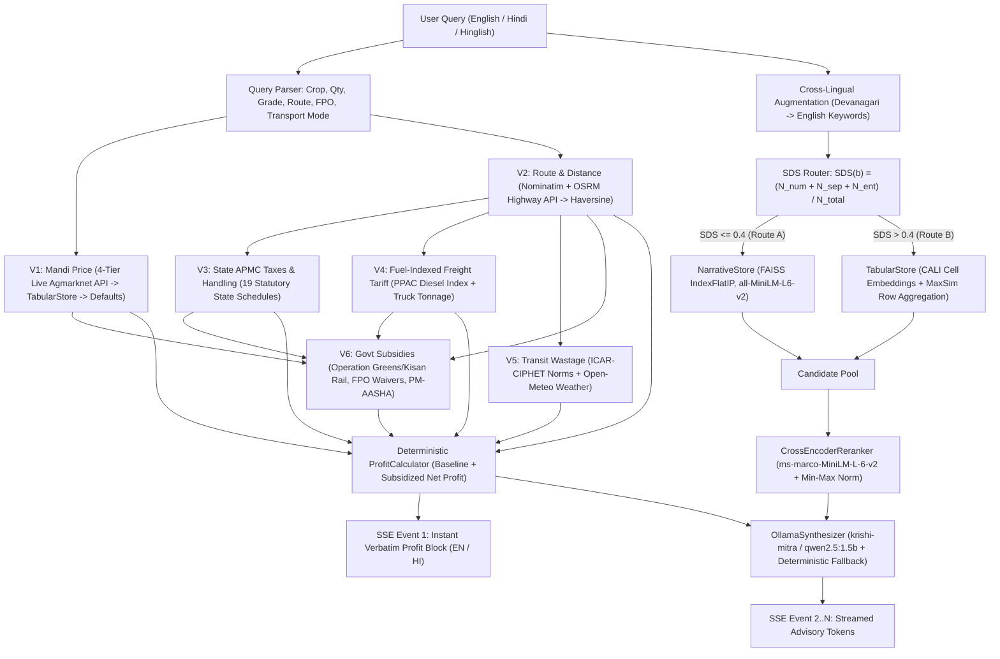

# Complete Project Analysis: Topo-RAG (Krishi Mitra)
**Topology-Aware Retrieval-Augmented Generation for Agricultural Price Discovery, Supply-Chain Logistics & Subsidy-Aware Profit Advisory**

---

## 1. Executive Summary

**Topo-RAG (Krishi Mitra)** is an end-to-end agricultural market advisory platform designed for Indian farmers. Standard Retrieval-Augmented Generation (RAG) pipelines struggle in agricultural commerce for two reasons:
1. **Structural Loss in Tabular Data:** Flattening wholesale market price tables (*mandi* arrival sheets) into plain text destroys row-column relationships, causing semantic retrievers to confuse prices across markets, grades, or dates.
2. **Hallucinated Arithmetic:** Large Language Models (LLMs) are unreliable when performing multi-step arithmetic over distances, freight tariffs, statutory taxes, perishability spoilage, and government subsidies.

Topo-RAG resolves both weaknesses by decoupling **retrieval routing**, **live & statutory parameter resolution**, **deterministic financial accounting**, and **natural-language advisory synthesis**:
* **Structural Density Score (SDS) Router** partitions queries and documents into narrative (*Route A*) and tabular (*Route B*) tracks.
* **Dual Vector Stores** combine a standard FAISS bi-encoder (`NarrativeStore`) with a ColBERT-inspired **Cell-Aware Late Interaction (`TabularStore` / CALI)** engine using MaxSim row aggregation.
* **6-Variable Dynamic Resolver Pipeline (`V1`–`V6`)** resolves live mandi prices, highway distances, statutory APMC taxes, fuel-indexed freight tariffs, weather-adjusted transit wastage, and government subsidies.
* **Deterministic Math Engine (`ProfitCalculator`)** performs exact Python float arithmetic—guaranteeing zero LLM hallucination in financial breakdowns—and passes a compact context summary to a local **Ollama (`krishi-mitra`, `qwen2.5:1.5b`)** model for bilingual (English & Hindi Devanagari) advisory generation via Server-Sent Events (SSE).

---

## 2. End-to-End System Architecture

---

## 3. Repository Structure & File Inventory

| File / Directory | Purpose |
| :--- | :--- |
| [app.py](file:///Users/aryandubeytopg/Downloads/7th%20sem%20Projects/IRSW%20PBL/app.py) | Flask web server (`port=5001`) with background warmup thread, `/api/ready`, `/api/chat/stream` (SSE), `/api/chat`, and `/api/reset`. |
| [templates/index.html](file:///Users/aryandubeytopg/Downloads/7th%20sem%20Projects/IRSW%20PBL/templates/index.html) & `static/styles.css` | Bilingual chat frontend consuming SSE streams (`calc`, `token`, `done`) with live streaming cursor management and session reset. |
| [main.py](file:///Users/aryandubeytopg/Downloads/7th%20sem%20Projects/IRSW%20PBL/main.py) | CLI entry point supporting `build`, `query`, `demo`, `validate`, and `sds <text>`. |
| [dataset_prep.py](file:///Users/aryandubeytopg/Downloads/7th%20sem%20Projects/IRSW%20PBL/dataset_prep.py) | ETL pipeline transforming raw Agmarknet CSV (`Agriculture_price_dataset.csv`, 737,392 data rows) into a clean, grade-mapped 15,000-row dataset (`topo_rag/data/raw/agmarknet_prices.csv`). |
| [topo_rag/core/data_loader.py](file:///Users/aryandubeytopg/Downloads/7th%20sem%20Projects/IRSW%20PBL/topo_rag/core/data_loader.py) | `AgmarknetLoader` (cell-mode CALI chunks & compact row chunks) and `NarrativeLoader` (sliding-window text/markdown chunker). |
| [topo_rag/core/sds_router.py](file:///Users/aryandubeytopg/Downloads/7th%20sem%20Projects/IRSW%20PBL/topo_rag/core/sds_router.py) | Structural Density Score (`SDSRouter`) classifier supporting English and Devanagari numerals/entities. |
| [topo_rag/stores/vector_stores.py](file:///Users/aryandubeytopg/Downloads/7th%20sem%20Projects/IRSW%20PBL/topo_rag/stores/vector_stores.py) | `NarrativeStore` (Route A bi-encoder) and `TabularStore` (Route B CALI cell index with MaxSim row aggregation). |
| [topo_rag/engine/reranker.py](file:///Users/aryandubeytopg/Downloads/7th%20sem%20Projects/IRSW%20PBL/topo_rag/engine/reranker.py) | `CrossEncoderReranker` with Min-Max score normalization across merged candidates. |
| [topo_rag/engine/dynamic_resolvers.py](file:///Users/aryandubeytopg/Downloads/7th%20sem%20Projects/IRSW%20PBL/topo_rag/engine/dynamic_resolvers.py) | `DynamicVariableResolver` (`V1`–`V5`) and `GovernmentSubsidyResolver` (`V6`) with bilingual English/Hindi provenance notes. |
| [topo_rag/engine/profit_calculator.py](file:///Users/aryandubeytopg/Downloads/7th%20sem%20Projects/IRSW%20PBL/topo_rag/engine/profit_calculator.py) | `ProfitCalculator` & `ProfitBreakdown` deterministic financial engine computing revenue, costs, subsidies, and per-kg / per-quintal profit. |
| [topo_rag/engine/pipeline.py](file:///Users/aryandubeytopg/Downloads/7th%20sem%20Projects/IRSW%20PBL/topo_rag/engine/pipeline.py) | `TopoRAGPipeline` orchestrator, multilingual regex parsers, 3-tier price hierarchy, and `TemplateSynthesizer`. |
| [topo_rag/engine/llm_synthesizer.py](file:///Users/aryandubeytopg/Downloads/7th%20sem%20Projects/IRSW%20PBL/topo_rag/engine/llm_synthesizer.py) | `OllamaSynthesizer` (aliased as `GeminiSynthesizer`) managing local Ollama inference, streaming, language-separated history, and deterministic fallback. |
| [KrishiMitra.Modelfile](file:///Users/aryandubeytopg/Downloads/7th%20sem%20Projects/IRSW%20PBL/KrishiMitra.Modelfile) | Custom Ollama Modelfile specializing `qwen2.5:1.5b` with Indian mandi domain knowledge and bilingual few-shot examples. |
| [topo_rag/tests/validate.py](file:///Users/aryandubeytopg/Downloads/7th%20sem%20Projects/IRSW%20PBL/topo_rag/tests/validate.py) | Unit and integration validation suite (`22` unit tests + `5` end-to-end sample query checks). |
| [topo_rag/utils/mock_data_generator.py](file:///Users/aryandubeytopg/Downloads/7th%20sem%20Projects/IRSW%20PBL/topo_rag/utils/mock_data_generator.py) | Synthetic fallback generator for Agmarknet CSV and static `transport_matrix.csv` (`40` city-pair rows). |
| [Docs/](file:///Users/aryandubeytopg/Downloads/7th%20sem%20Projects/IRSW%20PBL/Docs) | Project documentation: [Project_Datasets_and_Sources.md](file:///Users/aryandubeytopg/Downloads/7th%20sem%20Projects/IRSW%20PBL/Docs/Project_Datasets_and_Sources.md), [further_implementation.md](file:///Users/aryandubeytopg/Downloads/7th%20sem%20Projects/IRSW%20PBL/Docs/further_implementation.md), [run.txt](file:///Users/aryandubeytopg/Downloads/7th%20sem%20Projects/IRSW%20PBL/Docs/run.txt), and this analysis. |

---

## 4. Core RAG & Retrieval Pipeline Analysis

### 4.1 Data Preparation & Chunking
* **ETL ([dataset_prep.py](file:///Users/aryandubeytopg/Downloads/7th%20sem%20Projects/IRSW%20PBL/dataset_prep.py)):** Reads `Agriculture_price_dataset.csv` (`737,393` lines including header), removes zero-price rows and outliers above `₹50,000/quintal`, maps Agmarknet grades (`FAQ`/`Ref grade-1`/`Large` → `A`, `Medium`/`Non-FAQ` → `B`, `Local`/`Ref grade-2` → `C`), standardizes dates (`%d/%m/%Y`), and performs stratified sampling (`3,000` rows per commodity) into `topo_rag/data/raw/agmarknet_prices.csv` (`15,001` lines / `15,000` rows).
* **Tabular Chunking (`AgmarknetLoader`, `cell_mode=True`):** Converts each row into positional cell strings `[COL: <HEADER>] [ROW: <row_idx>] [VAL: <value>]` with full row-level metadata attached to every cell. During `main.py build`, up to `MAX_CELLS = 8,000` cells are randomly sampled (`seed=42`) and indexed.
* **Narrative Chunking (`NarrativeLoader`):** Splits markdown/text knowledge files using a sliding character window (`chunk_size=512`, `chunk_overlap=64`, step `448`).
* **Current Persisted FAISS Index State (`topo_rag/data/index/`):**
  * `tabular/tabular.index`: `8,000` vectors (`384` dimensions, `IndexFlatIP`).
  * `narrative/narrative.index`: `26` vectors (`384` dimensions, `IndexFlatIP`) built from `apmc_regulations.md` and `quality_standards.md`. *(Note: [government_schemes_subsidies.md](file:///Users/aryandubeytopg/Downloads/7th%20sem%20Projects/IRSW%20PBL/topo_rag/data/narrative/government_schemes_subsidies.md) was added separately and will be indexed into `narrative.index` upon re-running `./venv/bin/python main.py build`.)*

### 4.2 Structural Density Score (SDS) Routing ([sds_router.py](file:///Users/aryandubeytopg/Downloads/7th%20sem%20Projects/IRSW%20PBL/topo_rag/core/sds_router.py))
`SDSRouter` computes token-level structural density without requiring external NLP parsers like spaCy:

$$\text{SDS}(b) = \min\left(\frac{N_{\text{num}} + N_{\text{sep}} + N_{\text{ent}}}{N_{\text{total}}},\ 1.0\right)$$

* **$N_{\text{num}}$**: Arabic (`0–9`) and Devanagari (`०–९`) numbers, percentages, `₹`/`Rs.` currency tokens, and dates (`dd/mm/yyyy`).
* **$N_{\text{sep}}$**: Structural delimiters (`|`, `,`, `\t`, `;`).
* **$N_{\text{ent}}$**: Capitalized English proper nouns plus a curated `_KNOWN_ENTITIES` lexicon covering Indian commodities, mandis, and states in both English and Devanagari Hindi.
* **Routing Decision**: `SDS > 0.4` routes primarily to **Route B (`TabularStore`)** supplemented by `top_k // 2` narrative chunks (`AB`); `SDS <= 0.4` routes primarily to **Route A (`NarrativeStore`)** supplemented by `top_k // 2` tabular rows when available.

### 4.3 Dual Vector Stores & Cross-Encoder Reranking
* **Bi-Encoder (`all-MiniLM-L6-v2`):** Produces L2-normalized 384-dimensional embeddings stored in `faiss.IndexFlatIP` (cosine similarity via inner product).
* **CALI / MaxSim Search (`TabularStore.search`):** Retrieves `min(top_k * 20, ntotal)` candidate cells for the query, groups scores by logical row key (`row_key`), applies MaxSim aggregation ($\max_{\text{cell} \in \text{row}} \text{sim}(q, \text{cell})$), sorts rows, and reconstructs full pipe-delimited row context strings (`" | ".join(row_cells)`).
* **Cross-Encoder Reranker (`CrossEncoderReranker`):** Uses `cross-encoder/ms-marco-MiniLM-L-6-v2` when `use_fast=True` (default in `app.py` and `main.py`, ~80 MB) or `BAAI/bge-reranker-v2-m3` (`use_fast=False`, ~550 MB). Batch logits are Min-Max normalized to `[0, 1]` (returning `0.5` if all scores are equal) and truncated to `top_k=5`.

---

## 5. Six-Variable Dynamic Resolution Engine (`V1`–`V6`)

The core financial engine eliminates hardcoded static assumptions by resolving six external domain variables dynamically in [dynamic_resolvers.py](file:///Users/aryandubeytopg/Downloads/7th%20sem%20Projects/IRSW%20PBL/topo_rag/engine/dynamic_resolvers.py) and [pipeline.py](file:///Users/aryandubeytopg/Downloads/7th%20sem%20Projects/IRSW%20PBL/topo_rag/engine/pipeline.py):

| Variable | Symbol | Data Source & Access Pattern | Resolution Strategy & Fallbacks |
| :--- | :--- | :--- | :--- |
| **V1: Mandi Price** | $P_{\text{mandi}}$ (`₹/qtl`) | Agmarknet OGD API on `data.gov.in` (`resource_id=9ef84268-d588-465a-a308-a864a43d0070`) | **Tier 1A:** Live exact market/district match (`limit=100` state query → `limit=500` nationwide query, 1 retry). **Tier 1B:** Live destination-state average. **Tier 1C:** Live Metro/NCR (`_METRO_REGION_DISTRICTS`) or adjacent-state (`_NEIGHBORING_STATES`) average. **Tier 1D:** Live national Agmarknet average. **Tier 2:** Offline `TabularStore` CSV metadata fallback. **Tier 3:** Baseline commodity defaults. |
| **V2: Highway Route** | $D_{\text{km}}, T_{\text{hrs}}$ | OpenStreetMap Nominatim Geocoder + OSRM Driving API (`router.project-osrm.org`) | Geocodes source/destination cities & extracts states (falls back to `24`-city `curated_fallbacks` on SSL/network error). Queries OSRM road distance and calibrates commercial truck duration: $\max(1.35 \times T_{\text{raw}}, D / 48)$. Falls back to Haversine $\times 1.30$ road curvature factor at `42 km/h`. |
| **V3: APMC Taxes** | $\tau_{\text{apmc}}$ (`%`), $H$ (`₹/qtl`) | Statutory State APMC Schedules (`STATE_APMC_SCHEDULE`, 18 states/UTs + national default) | Maps destination state to notified Market Fee (`0.0%`–`2.0%`), Development Cess / RDF / HRDF (`0.0%`–`2.0%`), and mandi handling charges (`₹10`–`₹18/qtl`). Recognizes zero-APMC states (`Bihar`, `Kerala`). |
| **V4: Freight Tariff** | $R_{\text{tariff}}$ (`₹/qtl/km`) | PPAC Table 8.14 / Ready Reckoner ([ppac_diesel_state_index.json](file:///Users/aryandubeytopg/Downloads/7th%20sem%20Projects/IRSW%20PBL/topo_rag/data/raw/ppac_diesel_state_index.json), `35` states/UTs) | Selects vehicle payload class: • Heavy FTL (`≥ 80 qtl`): `₹0.68` ($\ge 600\text{ km}$) / `₹0.78` • MCV (`25–80 qtl`): `₹0.76` / `₹0.86` • LCV Pickup (`< 25 qtl`): `₹0.85` / `₹0.94` Scales by destination HSD diesel price relative to `₹90/L` baseline with `45%` fuel weight: $R = R_{\text{base}} \times \left(1 + 0.45 \times \frac{P_{\text{diesel}} - 90}{90}\right)$. |
| **V5: Transit Wastage** | $W_{\text{pct}}$ | ICAR-CIPHET baseline norms (`CIPHET_BASE_WASTAGE_RATES`) + Open-Meteo API | Queries live temp ($T$) and RH at origin & destination. For perishables: $W = \min\left(W_{\text{base}} \cdot (\max(T/25, 0.8))^{0.55} \cdot F_{\text{RH}} \cdot \left(1 + 0.10 \frac{T_{\text{hrs}}}{12}\right),\ 0.28\right)$. For non-perishable grains/oilseeds: $W = W_{\text{base}} \cdot (1 + 0.02 \frac{D_{\text{km}}}{500})$. |
| **V6: Govt Subsidies** | $S_{\text{total}}$ (`₹`) | Curated statutory index ([govt_subsidies_index.json](file:///Users/aryandubeytopg/Downloads/7th%20sem%20Projects/IRSW%20PBL/topo_rag/data/raw/govt_subsidies_index.json)) | Evaluates three active interventions: 1. **MoFPI Operation Greens / Kisan Rail:** `50%` freight relief on 43 crop entries (`≥ 90 qtl` & `≥ 100 km` by road; zero min qty on `kisan_rail` or `auto` corridors `≥ 250 km`). 2. **State APMC FPO / Horticulture Waivers:** Up to `100%` mandi fee waiver across 14 state profiles + Karnataka in-mandi F&V exemption. 3. **PM-AASHA PDPS & CACP MSP (`17` crops):** Direct DBT gap payment capped at `15%` of MSP for oilseeds; MSP procurement center alerts for pulses/cereals/cotton. |

---

## 6. Deterministic Profit Engine Formulation ([profit_calculator.py](file:///Users/aryandubeytopg/Downloads/7th%20sem%20Projects/IRSW%20PBL/topo_rag/engine/profit_calculator.py))

All financial arithmetic executes strictly in Python with zero LLM involvement:

1. **Quantity & Grade Price Adjustment:**
   $$Q_{\text{qtl}} = \frac{Q_{\text{kg}}}{100}, \qquad P_{\text{eff}} = P_{\text{mandi}} \times \left(1 + \frac{\text{grade\_premium\_pct}}{100}\right)$$
   *(Default pipeline mapping: Grade A = `+5%`, Grade B = `0%`, Grade C = `-5%`.)*
2. **Wastage & Sellable Yield:**
   $$Q_{\text{waste}} = Q_{\text{qtl}} \times W_{\text{pct}}, \qquad \text{Wastage Cost} = Q_{\text{waste}} \times P_{\text{eff}}, \qquad Q_{\text{sellable}} = Q_{\text{qtl}} - Q_{\text{waste}}$$
3. **Gross Revenue & Gross Costs:**
   $$\text{Gross Revenue} = Q_{\text{sellable}} \times P_{\text{eff}}$$
   $$\text{Transport Cost} = Q_{\text{qtl}} \times R_{\text{tariff}} \times D_{\text{km}}$$
   $$\text{APMC Commission} = \text{Gross Revenue} \times \frac{\tau_{\text{apmc}}}{100}, \qquad \text{Mandi Fees} = Q_{\text{qtl}} \times H$$
   $$\text{Total Costs}_{\text{gross}} = \text{Transport Cost} + \text{APMC Commission} + \text{Mandi Fees} + \text{Wastage Cost}$$
4. **Government Subsidy Relief & Final Subsidized Net Profit:**
   $$\text{Baseline Net Profit} = \text{Gross Revenue} - \text{Total Costs}_{\text{gross}}$$
   $$\text{Effective Gross Revenue} = \text{Gross Revenue} + S_{\text{price\_support}}$$
   $$\text{Effective Total Costs} = \max\left(\text{Total Costs}_{\text{gross}} - S_{\text{freight}} - S_{\text{mandi\_waiver}},\ 0\right)$$
   $$\text{Net Profit} = \text{Effective Gross Revenue} - \text{Effective Total Costs} = \text{Baseline Net Profit} + S_{\text{total}}$$
   $$\text{Net Profit / quintal} = \frac{\text{Net Profit}}{Q_{\text{qtl}}}, \qquad \text{Net Profit / kg} = \frac{\text{Net Profit}}{Q_{\text{kg}}}$$

Both English (`summary("en")`) and Hindi Devanagari (`summary("hi")`) outputs render verbatim calculation blocks along with localized `notes` / `notes_hi` provenance bullets.

---

## 7. Multilingual Query Parsing, LLM Synthesis & Web Interface

### 7.1 Multilingual Query Parsing ([pipeline.py](file:///Users/aryandubeytopg/Downloads/7th%20sem%20Projects/IRSW%20PBL/topo_rag/engine/pipeline.py))
* **Numeral Normalization:** Translates Devanagari digits (`०–९`) to ASCII (`0–9`).
* **Extraction Helpers:** Extracts quantity (supporting `kg`, `quintal`, `q`, `tonne`, `किलो`, `किग्रा`, `क्विंटल`, `टन`), grade (`A`/`B`/`C`, `ए`/`बी`/`सी`), crop (`_CROP_MAPPING` across English, Hindi, and Hinglish), source/destination markets (`_CITY_MAPPING`, handling `from X to Y`, `<src> से <dst>`, and positional lookup with trailing stopword filtering), FPO membership (`fpo`, `fpc`, `direct marketing`, `एफपीओ`, `सहकारी`), and transport mode (`kisan rail`, `किसान रेल`, `by road`).
* **Cross-Lingual Retrieval Bridge:** When Devanagari input is detected, `TopoRAGPipeline` prepends extracted English keywords (`crop`, `source`, `destination`) to the semantic retrieval query so the English-pretrained `all-MiniLM-L6-v2` stores and `ms-marco` reranker retrieve relevant chunks accurately.

### 7.2 Local LLM Advisory & SSE Streaming ([llm_synthesizer.py](file:///Users/aryandubeytopg/Downloads/7th%20sem%20Projects/IRSW%20PBL/topo_rag/engine/llm_synthesizer.py), [app.py](file:///Users/aryandubeytopg/Downloads/7th%20sem%20Projects/IRSW%20PBL/app.py), [index.html](file:///Users/aryandubeytopg/Downloads/7th%20sem%20Projects/IRSW%20PBL/templates/index.html))
* **Model Runtime:** Connects to local Ollama (`http://localhost:11434`) running custom persona `krishi-mitra` (built on `qwen2.5:1.5b` via [KrishiMitra.Modelfile](file:///Users/aryandubeytopg/Downloads/7th%20sem%20Projects/IRSW%20PBL/KrishiMitra.Modelfile)), using `num_ctx=4096`, `num_predict=420`, `temperature=0.3`, `repeat_penalty=1.15`, and `keep_alive=-1`.
* **Prompt & History Isolation:** Passes a compact 1-line `Context:` summary rather than the 2KB ASCII box table to prevent prompt echo and context overflow on the 1.5B model. Completed turns are recorded via `_record_history_turn` (max `4` messages / `2` turns) with automatic language-stream isolation (`_history_lang`), plus support for `"Translate in Hindi"` follow-ups on `_last_profit` / `_last_advisory`.
* **Non-Empty Advisory Guarantee:** If Ollama is offline, raises an error, or emits zero tokens (e.g., hitting `stop "###"`), `_deterministic_advisory` generates a complete rule-based Hindi or English advisory covering profitability, perishability/crate/night-transit advice, and subsidy documentation.
* **Streaming Web UI:** [app.py](file:///Users/aryandubeytopg/Downloads/7th%20sem%20Projects/IRSW%20PBL/app.py) warms up SentenceTransformer/CrossEncoder models in a background thread (`_warmup_pipeline`) and streams SSE events (`calc`, `token`, `done`) to [index.html](file:///Users/aryandubeytopg/Downloads/7th%20sem%20Projects/IRSW%20PBL/templates/index.html), which guards against concurrent submissions and clears the blinking cursor when streaming ends.

---

## 8. Validation & Empirical Behavior

Verified via `./venv/bin/python -m topo_rag.tests.validate`:
* **Unit Test Suite (`22/22` tests passing):**
  * `TestSDSRouter` (`5` tests): validates tabular vs. narrative partitioning, `[0, 1]` bounds, and empty input handling.
  * `TestProfitCalculator` (`6` tests): verifies exact arithmetic (`Pune → Azadpur`, 500 kg Grade-A Tomato baseline `₹2,133.65`), wastage sensitivity, distance sensitivity, grade premium monotonicity, zero-quantity safety, and non-negativity.
  * `TestDataLoader` (`2` tests): verifies `NarrativeLoader` chunking and `AgmarknetLoader` `[COL:]`/`[VAL:]` cell encoding.
  * `TestMinMaxNormalization` (`2` tests): validates reranker normalization including identical-score edge case (`0.5`).
  * `TestGovernmentSubsidyResolver` (`7` tests): verifies `govt_subsidies_index.json` loading, Operation Greens Kisan Rail vs. 9 MT road rules, Maharashtra/Karnataka/Punjab FPO & horticulture waivers, PM-AASHA 15% PDPS cap vs. Wheat MSP procurement advisory, full V6 accounting (`effective_total_costs`, `net_profit_per_qtl`), pure Hindi `notes_hi` localization, and live NCR/district fallback logic.
* **Observed Live Integration Behavior:**
  * Live `api.data.gov.in` resolved real-time `APMC Azadpur` Tomato modal price (`₹1,931.00/qtl`, dated `26/11/2026`), and cleanly resolved Delhi-NCR neighboring mandis when Delhi itself had not yet posted daily Tomato arrivals.
  * Live OSRM highway routing (`1,340.8 km`, `27.9h`) and Open-Meteo ambient weather resolved successfully; Nominatim geocoding hit a local LibreSSL certificate verification error and fell back seamlessly to `curated_fallbacks`.

---

## 9. Known Limitations & Planned Evolution

### Current Operational Limitations
1. **Local 1.5B LLM Hindi Fluency:** Because `qwen2.5:1.5b` is a lightweight 1.5B parameter local model, complex Hindi prose generation can occasionally contain minor grammatical artifacts compared to larger models. Cloud keys (`GROQ_API_KEY` / `GEMINI_API_KEY` referenced in [Docs/run.txt](file:///Users/aryandubeytopg/Downloads/7th%20sem%20Projects/IRSW%20PBL/Docs/run.txt) and `.env`) are not currently wired into `OllamaSynthesizer`, which ignores `api_key`.
2. **Narrative Index Sync:** Adding or editing files in `topo_rag/data/narrative/` (such as [government_schemes_subsidies.md](file:///Users/aryandubeytopg/Downloads/7th%20sem%20Projects/IRSW%20PBL/topo_rag/data/narrative/government_schemes_subsidies.md)) requires running `./venv/bin/python main.py build` to refresh `narrative.index`.
3. **Static Local Geocoder SSL Fallback:** On macOS Python builds using older LibreSSL, `nominatim.openstreetmap.org` TLS verification fails and falls back to the `24`-city `curated_fallbacks` coordinate table (unknown small towns default to central India coordinates unless resolved via Nominatim or added to the table).
4. **English-Centric Dense Embeddings:** `all-MiniLM-L6-v2` and `ms-marco-MiniLM-L-6-v2` optimize English semantic matching; Hindi queries rely on keyword translation in `TopoRAGPipeline`.

### Future Roadmap ([further_implementation.md](file:///Users/aryandubeytopg/Downloads/7th%20sem%20Projects/IRSW%20PBL/Docs/further_implementation.md))
* **Infrastructure:** Migrate FAISS to true multi-vector Qdrant/WARP, port Flask to async FastAPI, add PostgreSQL + PostGIS spatial distance matrices, and introduce Redis + Celery for caching and scheduled scraping.
* **Advisory Verticals:** Parallel **Sell vs. Store vs. Transport** optimization with cold-storage availability, metadata-filtered scheme staleness tracking, and shared truck-pooling across neighboring farmers.
* **Channels & Benchmarking:** WhatsApp bot deployment via Twilio and automated `nDCG@10` benchmarking across Type A (narrative), Type B (cell-precise), and Type C (hybrid) queries, plus GraphRAG multi-hop reasoning.
