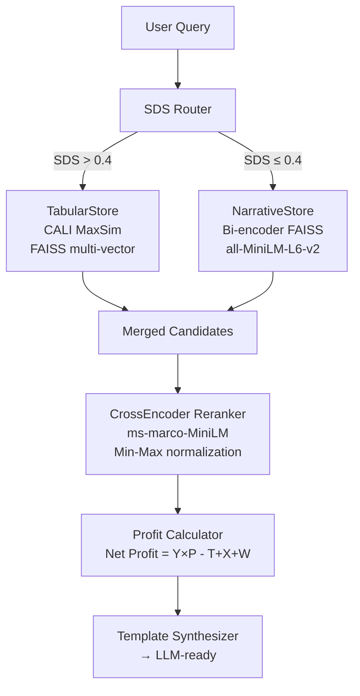

# Topo-RAG MVP — Implementation Summary

## ✅ Build Output (Verified)

| Stage | Result |
|-------|--------|
| Data generation | **4,802** synthetic Agmarknet price records (90 days, 12 markets, 8 commodities) |
| Transport matrix | **40** bidirectional city-pair routes |
| Cell-level chunks (Route B) | **28,812** total; **5,000** indexed for MVP |
| Narrative chunks (Route A) | **26** chunks from 2 APMC/quality documents |
| Embedding model | `all-MiniLM-L6-v2` on Apple MPS — 64.8s index time |
| Index size on disk | FAISS IndexFlatIP dim=384 |
| Unit tests | **15/15 PASS** |

---

## ✅ Validation Queries — Sample Results

### Query 1: `500kg Grade-A Tomatoes, Pune → Azadpur`
```
  GROSS REVENUE        ₹    9,817.50
  Transport Cost       ₹    5,680.00   (5q × ₹0.8/q/km × 1420km)
  APMC Commission      ₹      196.35   (2% of gross)
  Mandi Fees           ₹       75.00   (₹15/q × 5q)
  Wastage Loss         ₹    1,732.50   (15% of Tomato)
  NET PROFIT           ₹    2,133.65
  Net Profit / kg      ₹        4.27
```

### Query 3: `1000kg Grade-B Potato, Indore → Mumbai`
```
  GROSS REVENUE        ₹   11,280.00
  Transport Cost       ₹    4,720.00   (10q × ₹0.8/q/km × 590km)
  NET PROFIT           ₹    5,464.40
```

### Query 5: `500kg Onion, Nashik → Delhi`
```
  GROSS REVENUE        ₹    8,694.00
  Transport Cost       ₹    5,520.00   (5q × ₹0.8/q/km × 1380km)
  NET PROFIT           ₹    2,169.12
```

---

## Architecture Components



---

## SDS Formula Implementation

```python
SDS(b) = (N_num + N_sep + N_ent) / N_total

# Example: "Tomato | Azadpur | 2400 | Grade A | Maharashtra"
# N_num=1 (2400)
# N_sep=4 (four | pipes)
# N_ent=3 (Tomato, Azadpur, Maharashtra)
# N_total=13 tokens
# SDS = 8/13 = 0.615 → Route B (Tabular) ✓
```

---

## Net Profit Formula

```
Net Profit = (Yield × Price) − (Transport + Taxes + Wastage)

Where:
  Yield    = Sellable quantity (post-wastage deduction)  [quintals]
  Price    = Modal price from mandi × grade premium      [₹/quintal]
  Transport= qty_q × tariff_per_q_km × distance_km      [₹]
  Taxes    = APMC commission (2%) + Mandi fees (₹15/q)  [₹]
  Wastage  = qty_q × wastage_rate × modal_price          [₹]
             Tomato=15%, Onion=8%, Potato=6%, Wheat=2%
```

---

## Production Upgrade Path

| Component | Current MVP | Production |
|-----------|-------------|------------|
| Bi-encoder | `all-MiniLM-L6-v2` (22MB) | `BAAI/bge-m3` (1.1GB) |
| Reranker | `ms-marco-MiniLM-L-6-v2` | `BAAI/bge-reranker-v2-m3` |
| Vector store | FAISS CPU | Qdrant / Weaviate multi-vector |
| LLM | Template | Gemini Pro / GPT-4o / LLaMA-3 |
| Data | Synthetic CSV | Live Agmarknet API + e-NAM |
| Deployment | Local Python | FastAPI + Docker + GCP Run |

---

## File Map

| File | Role |
|------|------|
| [`main.py`](file:///Users/aryandubeytopg/Downloads/7th%20sem%20Projects/IRSW%20PBL/main.py) | CLI: build / query / demo / validate / sds |
| [`sds_router.py`](file:///Users/aryandubeytopg/Downloads/7th%20sem%20Projects/IRSW%20PBL/topo_rag/core/sds_router.py) | SDSRouter, SDSResult, sliding window |
| [`data_loader.py`](file:///Users/aryandubeytopg/Downloads/7th%20sem%20Projects/IRSW%20PBL/topo_rag/core/data_loader.py) | AgmarknetLoader (cell+row), NarrativeLoader |
| [`vector_stores.py`](file:///Users/aryandubeytopg/Downloads/7th%20sem%20Projects/IRSW%20PBL/topo_rag/stores/vector_stores.py) | NarrativeStore, TabularStore (CALI MaxSim) |
| [`reranker.py`](file:///Users/aryandubeytopg/Downloads/7th%20sem%20Projects/IRSW%20PBL/topo_rag/engine/reranker.py) | CrossEncoderReranker + Min-Max norm |
| [`profit_calculator.py`](file:///Users/aryandubeytopg/Downloads/7th%20sem%20Projects/IRSW%20PBL/topo_rag/engine/profit_calculator.py) | Deterministic math engine + ProfitBreakdown |
| [`pipeline.py`](file:///Users/aryandubeytopg/Downloads/7th%20sem%20Projects/IRSW%20PBL/topo_rag/engine/pipeline.py) | TopoRAGPipeline orchestrator |
| [`mock_data_generator.py`](file:///Users/aryandubeytopg/Downloads/7th%20sem%20Projects/IRSW%20PBL/topo_rag/utils/mock_data_generator.py) | Synthetic Agmarknet CSV generator |
| [`validate.py`](file:///Users/aryandubeytopg/Downloads/7th%20sem%20Projects/IRSW%20PBL/topo_rag/tests/validate.py) | 15 unit tests + integration demo |
| [`apmc_regulations.md`](file:///Users/aryandubeytopg/Downloads/7th%20sem%20Projects/IRSW%20PBL/topo_rag/data/narrative/apmc_regulations.md) | Route A knowledge base (APMC, grading, transport) |
| [`quality_standards.md`](file:///Users/aryandubeytopg/Downloads/7th%20sem%20Projects/IRSW%20PBL/topo_rag/data/narrative/quality_standards.md) | Route A knowledge base (export specs, contracts) |
